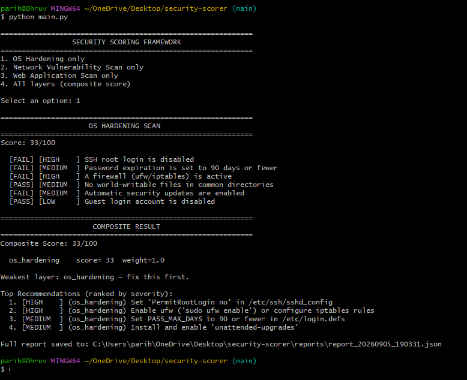
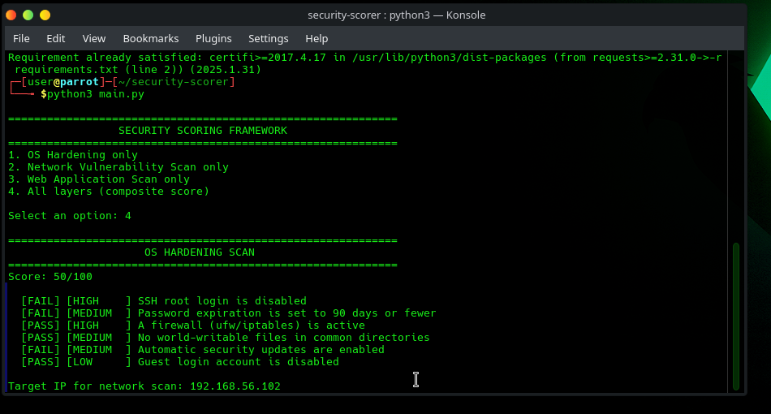
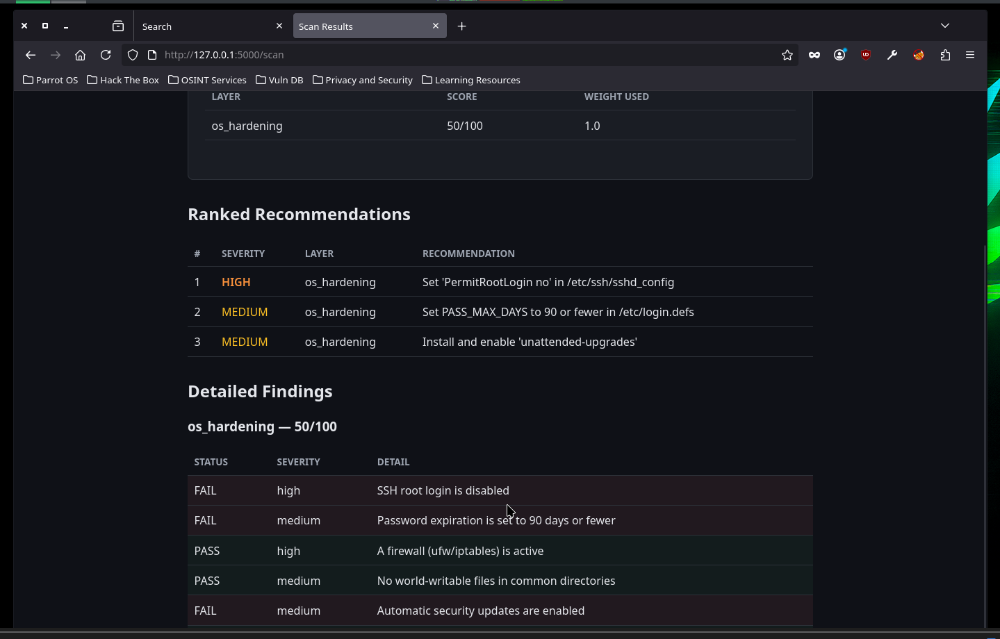

# OS Hardening Scan

The scanner checks the machine on which it is running. It does not remotely
inspect the operating system of an IP address supplied to the network scanner.
An OS score for a lab VM therefore requires running the local OS assessment
inside that VM; a remote Metasploitable network scan is a separate layer.
For longitudinal database storage, bind the local run explicitly to an
authorized target record. Without that binding, the scorer remains report-only.

## Versioned local control profiles

The current scorer exposes platform-specific profiles. Their check sets and
denominators differ; these are prototype indicators, not full benchmark
compliance reports.

| Profile | Checks | Live validation status |
|---|---|---|
| Linux (`linux_local_v1`) | SSH root-login setting; password max age; firewall; world-writable files; automatic updates; guest-login setting | Existing Linux checks; per-distribution and checklist mapping still needed |
| Windows (`windows_local_v1`) | Domain/Private/Public firewall profiles; UAC `EnableLUA`; built-in Guest account | Unit-tested; current Windows environment denied two read-only queries, so no complete score was emitted |
| macOS (`macos_local_v1`) | Application Firewall; FileVault; Gatekeeper; System Integrity Protection | Unit-tested only; native Mac validation is pending |

PASS and FAIL findings contribute with the unchanged ordinal weights (high=3,
medium=2, low=1). NOT_APPLICABLE, NOT_TESTED, ERROR, and UNKNOWN are not failures.
If any check returns ERROR, the profile preserves the finding but suppresses
the aggregate OS score rather than presenting a misleading partial percentage.
The report and each persisted assessment include the profile name and
total/evaluated/error/N/A counts. The report and database also retain
allowlisted platform identity: Linux distribution/release, Windows product,
edition, display version and build, or macOS product version and hardware
model, when the local read-only query is available. Identity-query failures
are marked as missing metadata and do not alter a control score. Each
finding's `check_version` carries the versioned profile identifier. These
fields improve traceability but do not replace a hash-verified raw-output
manifest or benchmark/authorization provenance.

The checks are not a certification of CIS, Microsoft, Apple, or NIST benchmark
compliance. Exact source versions and control mappings must be selected and
recorded before empirical collection. Compare before/after results within the
same versioned machine instance. Do not rank Windows, Linux, Parrot, and macOS
by raw scores when their controls or denominators differ.

## Usage (CLI)

```bash
python3 main.py
# Select option 1
```

## Results

The scores below are archived historical observations from an earlier scoring
version. They are preserved as originally reported, not recomputed under the
current model, and should not be compared directly with new version 1.3 scores
without the original findings and scoring provenance.

### Windows host (baseline — unconfigured system)
Score: **33/100** — typical for a default Windows/developer machine
with no specific hardening applied.

### Parrot OS (attack machine)
Score: **50/100** — better baseline since Parrot ships with a firewall
active and guest login disabled by default, but still missing SSH
hardening and automatic updates.

## Screenshots

| | |
|---|---|
|  | CLI output: OS hardening scan on Windows host — score 33/100 |
|  | CLI output: OS hardening scan on Parrot OS — score 50/100 |
|  | Web UI showing OS hardening results with ranked recommendations |
